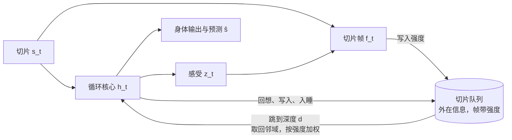
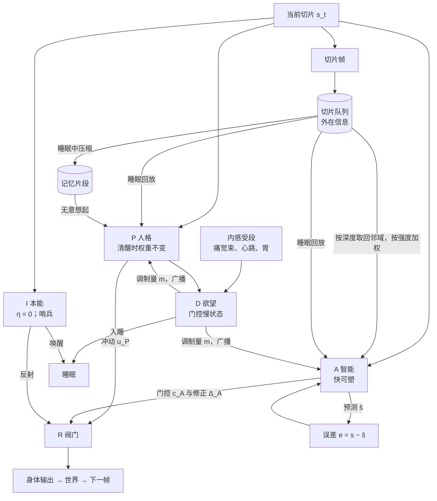

# Oneiros 候选智能体架构

> v0.3 · 2026-11-06
> 配套：`PRINCIPLES.md`（假设 H0–H6）、`SANDBOX.md`（身体、世界、默认大脑）、`EMOTIONS.md`（预期现象与证伪条件）
>
> **v0.3 的改动**
> - 有意回想不再需要逐帧走 d 步。改为一次跳到深度 d，取回它前后一段邻域的帧，并按帧的强度加权（2.2 节）。
> - 每一帧都带强度：写入时由内部动作给出，之后随时间衰减，被回想时增强。队列满时，移除强度最小的帧。
> - 睡眠回放时，每一帧对可塑性的作用乘以它的强度。
>
> **v0.2 的改动**
> - 不再照搬草稿的连线。第 1 节列出草稿中的问题和修正办法。
> - 历史有了到达人格层的通道。
> - 回想改为顺序读取，代价随深度线性增加。
> - 加入睡眠（第 3 节）。
> - Transformer 候选改为"免费访问"对照。

## 0. 这份文档是什么

本文给出六个候选大脑。它们共用同一个身体、世界、演化方式和观测，只在大脑结构上不同。

- **架构是设计者给出的形式，但只是待检验的假设。** 架构属于"学习规则的形式"（`PRINCIPLES.md` 2.1 节），可以由设计者给出；但每一种都只是结构假设，不是蓝图。
- **架构与臂正交。** 每个架构都可以跑 `fixed`、`hebb`、`hebb_pred`、`readable`、`no_body_loop`，以及睡眠的三个对照臂（3.6 节）。
- **共用的两套机制：** 第 2 节的记忆与回想，以及第 3 节的睡眠。各候选只在核心结构上不同。

| 候选 | 一句话 |
|---|---|
| B0 循环基线 | 历史只存在于循环状态和可塑权重里；睡眠只做突触巩固 |
| B1 免费访问对照 | 用 Transformer 并行读取整个切片队列，回想没有代价、也不看强度；用来检验代价和强度这一结构起不起作用 |
| B2 有意回想 | 切片队列是外在信息；网络可以跳到任意深度，取回一段邻近的帧并按强度加权；读得越宽，代价越大 |
| B3 有意回想 + 记忆片段 | 睡眠中把切片压缩成片段；清醒时，线索会自动唤起片段 |
| B4 多时间尺度 | 不分模块，每个单元的快慢由演化决定 |
| B5 修正后的四层 | 把草稿修正之后实现为模块，检验这个先验有没有用 |

---

## 1. 草稿中的问题与修正

v0.1 照搬了草稿的连线，这是错误的。下表列出问题，第 1、2 条是你指出的。

| # | 问题 | 后果 | 修正 |
|---|---|---|---|
| 1 | 切片队列只连到智能层，人格层得不到任何历史 | 人格只能由遗传决定，不能被经历塑造；这与"人格在经验中缓慢改变"矛盾 | 历史经两条通道到达人格层：睡眠回放把经历巩固进人格层的慢权重（3.4 节）；清醒时，线索会自动唤起记忆片段，送进人格层（2.3 节） |
| 2 | v0.1 的读取深度 d 是一次并行读取 | 回想几乎是免费的，与"读深度 d 必须包含之后所有的帧"矛盾，记忆的经济问题也就不存在了 | 回想要付出代价。v0.2 曾改为逐帧走 d 步，过于严苛；v0.3 改为一次跳到深度 d，取回前后一段邻域并按强度加权，代价与读到的帧数成正比。深处的代价由强度衰减承担（2.2 节） |
| 3 | 没有睡眠 | 慢权重无从更新；队列满了只能丢帧；记忆片段从哪里来也没有交代 | 加入睡眠这一身体状态：回放、巩固、生成片段、清空队列（第 3 节） |
| 4 | 智能层只能控制阀门，不能提出动作 | 一生中学到的东西只能用来压住人格层的冲动，学不会新的做法 | 阀门同时接受智能层的门控和加性修正：`out = u_P ⊙ c_A + Δ_A + 反射` |
| 5 | 本能层到不了输出 | 突发事件要先绕经欲望层和人格层，才能做出反应 | 本能层有一条直通阀门的路径；睡眠中它保持在线，负责唤醒（哨兵） |
| 6 | 记忆片段放在欲望层里 | 动机和记忆混在一起，欲望层的"受控更新"会约束记忆的写入和遗忘 | 记忆系统独立出来。欲望层只做一件事：把身体的模式信号转成调制信号，广播给人格层和智能层的可塑性 |
| 7 | 欲望层用整个感官切片计算"目标误差" | 新设计里，身体状态只能经痛觉束和心跳感到；让欲望层看全部感官，等于把世界的语义也交给了它 | 欲望层的输入只取内感受段（痛觉束、心跳、胃充盈）和人格层的状态 |
| 8 | 切片残差每 tick 直接送进人格层 | 人格层会随每个误差即时改变，与"慢"矛盾 | 清醒时，人格层的权重不变，激活照常响应输入；残差只在睡眠回放中作用于它的权重 |
| 9 | 阀门的输出回送欲望层（R → D），含义不明 | — | 取消这条专线。阀门的输出进入传出副本，所有模块在下一帧都能看到 |
| 10 | 没有预测，也没有闭环 | — | 智能层输出预测 ŝ；身体输出经过世界，回到下一帧 |
| 11 | v0.1 的 Transformer 候选可以并行、免费地访问整个窗口 | 违反第 2 条 | 保留，但改为对照（B1），并明确标为"免费访问" |

---

## 2. 记忆与回想（所有带切片队列的候选共用）

### 2.1 切片帧与切片队列

```
切片帧：f_t = [s_t ; z_t]，z_t = tanh(W_z·h_{t−1})（k_z = 8，即"感受"）
切片队列：最多 L_q = 64 帧，按新旧排序（位置 j = 1 是最新的一帧），不带时间戳
写入：清醒时每 tick 写入一帧，写入强度 σ = (u_w + 1) / 2，u_w 是内部动作
衰减：每 tick σ_j ← σ_j · (1 − λ_q)，λ_q 写在基因组里
溢出：队列满时，移除强度最小的帧；强度相同时，移除较旧的那一帧
睡眠中不写入，所以睡眠本身不会被记住
存储代价：c_tot += c_store · Σ_j σ_j        按强度连续计费
```

- **切片队列是外在信息。** 它是感官历史的延伸，不属于任何一个模块的内部状态。清醒时，只有执行有意回想的那一方能读取它：B5 里是智能层，其他候选里是整个网络。
- **"记住什么"由强度决定。** 强度会衰减，所以旧的帧通常先被挤掉；但写入时被标得很强的帧（比如疼痛或意外的时刻）可以留得更久。每一帧写多强，由演化出的内部动作决定，不设计任何"重要性"公式。所以要观察的是：写入强度会不会自己集中到疼痛和意外的时刻，也就是情绪标记会不会涌现。
- **队列里的位置不等于时间。** 弱的帧被移除后，相邻两帧之间可能隔了很久。按草稿 QA 的立场，系统得不到任何时间戳，"隔了多久"只能从帧的内容推断。
- **溢出即遗忘。** 被挤掉的帧，如果在此之前没有在睡眠中回放过，就永远丢失了。队列只有 64 帧，远小于一天的长度（T_day 约 200 tick），所以写入强度和睡眠频率之间存在真实的取舍。

### 2.2 有意回想：按深度取回邻域，按强度加权

```
每个 tick，内部动作 u_rc ∈ [−1, 1]：u_rc ≤ 0 时不回想；u_rc > 0 时本 tick 回想一次
深度：内部动作 u_d 决定 d = 1 + (n − 1)·(u_d + 1)/2，n 是队列当前的帧数，d 是连续值
邻域核：K(j) = exp(−(j − d)² / (2·w_new²))，j < d（比 d 更新的一侧）
        K(j) = exp(−(j − d)² / (2·w_old²))，j ≥ d（比 d 更旧的一侧）
        w_new、w_old 写在基因组里，初值都是 2
读取：r_t = Σ_j K(j) · σ_j · W_v·f_j / (ε + Σ_j K(j))
      分母只按核的总量归一化，不按强度归一化：弱的帧读回来就是弱的，容易被困倦噪声淹没
增强：被读到的帧 σ_j += κ_rc · K(j) · (1 − σ_j)，κ_rc 写在基因组里
代价：能量 c_rc · Σ_j K(j)，困倦 s_rc · Σ_j K(j)      与实际读到的帧数成正比，与深度无关
```

- **为什么这样改。** v0.2 要求读到深度 d 必须逐帧走 d 步，代价随深度线性增加，而且想得越远越久不看眼前，这过于严苛。现在一次就能跳到任意深度，代价来自读得有多宽，而不是有多深。深处的代价改由强度的衰减承担：越旧的帧通常越弱，读回来越模糊。
- **邻域的宽度和不对称都交给演化。** 两侧宽度不同，意味着回想一个时刻时，更倾向于连带想起它之后发生的事，还是之前发生的事。人类自由回忆中的时间邻近效应有前向不对称，比值约为 2:1（Kahana 1996；Howard & Kahana 2002）；旧仓库的合成实验只做到 1.39。这里要看 w_new 与 w_old 的比值会被演化推向哪里。
- **回想会强化被想起的东西。** 被读到的帧强度上升，所以越常想起的越不容易被挤掉，富者愈富和反刍有了条件。"回想时增强"这一形式是设计出来的，所以要做 κ_rc = 0 的对照。
- **可以连续回想。** 连续几个 tick 移动 d，就能像"在脑中倒带"一样扫过一段经历；要不要这样做，由演化决定。
- **可选：`recall.occupies_reader: true`。** 打开后，回想所在的 tick 里，回想者不处理当前切片，用来检验"想事情时错过眼前"这一代价是否重要。默认关闭。

### 2.3 无意想起：记忆片段按内容自动唤起

```
记忆片段库：M = 32 个片段，每个片段有 (key_i, v_i, σ_i)；片段只在睡眠中生成（3.4 节）
每个 tick：cue_t = W_cue · [s_t ; h_P]
          a_i = softmax_i(β · cue_t · key_i) · σ_i
          r_P = Σ a_i · v_i                   送进人格层（非模块化的候选：送进核心）
被唤起时 σ_i += κ_ret · a_i；每 tick σ_i ← σ_i · (1 − λ_seg)
代价：c_tot += c_seg · Σ σ_i                 按强度连续计费，不设阈值
β、κ_ret、λ_seg 写在基因组里
```

- **两种回忆。** 有意回想是主动的、按位置的、有代价的，回到的是原始的帧。无意想起是自动的、按内容的、便宜的，得到的是压缩后的概要。这对应"回忆是重建，不是回放"（Bartlett 1932）。
- **这是人格层在清醒时接触历史的通道。** `EMOTIONS.md` 里一系列与记忆有关的现象，都要通过它才可能出现：
  - 哀的阵发：旧地点或亲属的气味唤起片段；
  - 创伤：伤害片段的强度不降反升；
  - 富者愈富与反刍：越被唤起越强；
  - 心境一致的回忆：键里含有 z。

### 2.4 记忆的代价汇总

| 项 | 计费方式 | 初值 |
|---|---|---|
| 队列存储 | 按 Σσ 每 tick | c_store = 1e-5 |
| 有意回想 | 按读到的帧数 Σ K | c_rc = 1e-4，s_rc = 4e-4（约合每次读 5 帧的代价为 5e-4 和 0.002） |
| 片段保持 | 按 Σσ 每 tick | c_seg = 1e-5 |
| 无意想起 | 包含在片段保持中 | — |

参照：基础代谢为 0.002/tick。以上代价都要在 M1 做扫描，并报告整条曲线。

---

## 3. 睡眠（所有候选共用）

### 3.1 睡眠压力（Process S）

```
困倦压力 S ∈ [0, 1]
清醒：S += s_awake + s_rc · (本 tick 回想的步数)，s_awake = 1 / (0.75·T_day)
睡眠：S −= s_sleep，s_sleep = 1 / (0.25·T_day)
感觉：困倦是痛觉束的第九个噪声源，强度为 S，周期 30，阻尼 0.97（SANDBOX 5.6）
影响：所有隐单元的输入加上噪声 σ_n · S · ξ，σ_n = 0.3     越困，想得越乱
```

- **压力来自两个方面：** 清醒的时长，以及想得多不多。这参照 Borbély 的双过程模型里的 Process S（Borbély 1982）。
- **不内置生物钟（Process C）。** 昼夜节律只存在于世界的光照和温度里，要不要跟着它睡，由演化决定。内置振荡器留作可选项（`body.circadian`）。

### 3.2 入睡与醒来

- **入睡：** 内部动作 `u_sleep > 0`。在 B5 中，这个动作由欲望层输出；在其他候选中，它是网络的一个输出。
- **醒来：** 睡眠中，哨兵输出 `u_wake > 0` 即醒来。哨兵在 B5 中是本能层；其他候选中，则由网络每 tick 处理一次当前切片（视野为 0）并给出 u_wake。
  - 是否被疼痛、触碰或声音唤醒，由演化决定，没有强制唤醒的规则。
- **何时睡、睡在哪里、睡多久，都不设计。**

### 3.3 睡眠中的身体

| 项 | 规则 |
|---|---|
| 运动 | 身体输出无效，速度按阻力衰减到 0 |
| 档位 | 固定为 0，所以产热减少；在冷的地方睡会变冷 |
| 视野 | 关闭：像素为 0 加噪声。其他感官照常 |
| 代谢 | 基础代谢 × 0.5 |
| 切片队列 | 不写入 |
| 被咬、中毒、体温 | 照常发生，睡着的个体同样会受伤 |

### 3.4 睡眠中的大脑：顺序回放与巩固

```
每个睡眠 tick：
  1 哨兵处理一次当前切片，给出 u_wake
  2 顺序回放：从队列中最旧的、尚未回放的帧开始，正序取出 n_sleep = 8 帧
    逐帧作为输入送进网络（B5 中送进人格层和智能层），可塑性照常运行，每一帧的作用乘以它的强度 σ_j：
      - 预测离线学习：预测序列中的下一帧，W_pred 按误差更新
      - 调制 Hebbian：调制量由回放帧的内感受段算出（B5 中由欲望层算）
        所以，当时痛不痛、饿不饿，决定了这段经历能在多大程度上改变自己
      - 事件边界：内部动作 u_b > 0，或者已累计 K = 16 帧，就把自上一个边界以来的帧
        压缩成一个记忆片段（仅 B3、B5）：
          v = tanh(W_c · [mean(这些帧) ; 最后一帧])，key = W_kk · v，σ = 写入强度 u_σ 映射到 [0, 1]
          片段库满时，替换 σ 最小的那个
    回放过的帧从队列中移除
  3 突触巩固：W_slow += ρ_j · W_fast，W_fast ← (1 − ρ_j) · W_fast     ρ_j 写在基因组里，每个单元一份
被提前唤醒：没回放完的帧留在队列里，但之后可能被新帧挤掉
```

- **回放的权重不设计。** 旧文档的重放权重是"唤醒 × 新奇 × 目标相关性"，属于设计。这里一律顺序回放，每段经历的影响大小由两样演化出来的东西决定：写入时给的强度，以及回放时的调制量。
- **回放比真实时间快。** 每个睡眠 tick 回放 8 帧，对应睡眠中压缩的重放（Wilson & McNaughton 1994）。
- **巩固之后，可塑权重才会长期保留。** 清醒时的 W_fast 会按 λ 衰减；只有在睡眠中转入 W_slow 的部分能留下来。这参照互补学习系统理论（McClelland et al. 1995），以及"睡眠下调突触"的假说（Tononi & Cirelli 2006）。

### 3.5 旧文档中的睡眠特性，在新设计里的位置

| 旧特性 | 新设计中的地位 |
|---|---|
| 由睡眠压力驱动（Process S） | 条件：S 随清醒和回想上升，以困倦噪声的形式被感到，并让思维变乱（3.1 节） |
| 入睡前收尾 | 观察：入睡前是否先吃饱、回到灌木丛 |
| 事件切分（Zacks） | 形式是设计的：边界是内部动作。观察：边界是否落在误差大的地方 |
| 加权重放 | 改为顺序回放，作用乘以帧的强度和调制量；两者都由演化决定，不设计权重公式 |
| 语义化、时间金字塔 | 观察：在片段压缩、容量竞争和强度衰减的作用下，越旧的片段是否越"粗"（探针能解码出的细节更少） |
| 情绪剥离与教训提炼 | 观察：同一片段经过多次睡眠后，探针能解码出的痛觉强度是否下降，负面事件是否下降得更快（褪色偏差）；而回避行为保留下来，这就是"教训" |
| 心境回归 | 观察：醒后慢状态是否回到基线（B4 的慢单元） |
| 剪枝 | 条件：容量与强度竞争 |
| 被唤醒、睡眠惯性 | 条件：回放没做完；醒来时 S 还没降完，思维仍然乱。观察：刚醒时表现是否变差 |
| 睡眠不被记住，醒后推断睡过 | 条件：睡眠中不写入队列。观察：醒后的行为是否表现出"知道过去了一段时间"，例如天亮后的预期行为 |
| 睡眠后的保持优势（旧文档的"24 小时跳变"） | 观察：睡眠之后对有毒浆果的回避，是否比清醒了同样时长的对照保持得更好 |
| 昏迷 | 不适用：沙箱里没有操作者 |

### 3.6 睡眠的对照臂（检验 H6）

| 臂 | 规则 | 用途 |
|---|---|---|
| `sleep: full` | 完整睡眠，即 3.1–3.4 节 | 主臂 |
| `sleep: no_replay` | 有睡眠状态和突触巩固，但不回放、不生成片段，入睡时队列直接清空 | 检验回放本身的作用 |
| `sleep: off` | 没有睡眠状态，没有 S；巩固在清醒时连续进行，总速率与 full 相同 | 检验睡眠作为一种"离线状态"本身是否有用 |

---

## 4. 候选架构

### 4.1 B0 循环基线

- **结构：** `SANDBOX.md` 6.1 节的调制可塑循环网络（H = 32），加上 3.4 节的突触巩固。没有切片队列，也没有片段。
- **设计意图：** 最小对照。历史只存在于循环状态 h 和权重里；人格对应慢单元，在睡眠中由 W_fast 巩固而来。
- **检验：**
  - H0、H2：每个单元的 η 和 ρ 是否分群；
  - H6：没有回放，睡眠是否仍然会出现。
- **代价：** 最低。主要风险是记忆太短，长程规律学不到。

### 4.2 B1 免费访问对照

- **结构：** 用 Transformer 读取 2.1 节的切片队列：每个 tick 对整个队列做因果自注意力（1–2 层，d = 32，2 个头，不加位置编码），没有回想代价，也没有回想时间。睡眠与其他候选相同。
- **设计意图：** 这是你最初的设想："切片帧就是 token，每次输出后预测下一帧，再计算差异"。但它对历史的访问是并行且免费的，所以只作为对照：
  - 回想要付代价、帧有强度且会衰减这一结构，会不会改变结果？
  - 一些人类特有的记忆现象，例如时间邻近与前向不对称、反刍的耗竭、旧事模糊，是否只在 B2、B3 里出现，而在 B1 里不出现？
- **检验：** B1 对 B2，规模匹配。
- **代价：** 基因组约 15–24k。用变异演化注意力权重可能更难。

### 4.3 B2 有意回想



- **结构：** B0 的核心，加上 2.1–2.2 节的切片队列和有意回想，以及 3.4 节的睡眠回放（回放进核心本身）。
- **设计意图：**
  - 按字面实现你对切片队列的定义：它是外在信息，由系统自发管理，读深度 d 必须连续读取。
  - 回想有能量和时间上的价格，所以"何时回想、想多深"是一个经济问题。
  - 帧中包含感受 z，为依赖状态的记忆提供条件。
- **检验：**
  - 回想深度是否随利害和新异程度变化？
  - 写入强度是否集中在误差大、疼痛的时刻，即情绪标记能否自己涌现？
  - 演化出的邻域宽度 w_new、w_old 是多少，两侧是否不对称（时间邻近与前向不对称）？
  - 帧中包含与不包含 z 的对照（`frame.feeling: on/off`）。
- **退化条件：** 回想、写入和回放全部关闭，且代价为 0 时，B2 退化为 B0。变异按块派生随机数，所以额外的块不影响原有块的抽样。
- **代价：** 基因组约 11k，每个个体约 75 KB（队列 64 × 78 个数）。

### 4.4 B3 有意回想 + 记忆片段

- **结构：** B2，加上 2.3 节的无意想起，以及 3.4 节中片段的生成。
- **设计意图：**
  - 区分你定义的 Slice 和 Segment。切片是工作记忆：外在信息，按位置读取，读起来有代价，越旧越模糊。片段是情景记忆：在睡眠中由切片压缩而成，按内容自动唤起，读起来便宜，但只是概要。
  - 事件边界、写入强度、衰减率和唤起增益，都交给演化。
- **检验与预期现象**（对应 `EMOTIONS.md`）：
  - 在有长程规律的世界里（毒性切换周期 ≥ L、需要回到原来的灌木、有亲属），B3 是否胜过 B2？
  - 边界是否落在误差大的地方（事件分割）？
  - 演化出的 λ_seg 是否符合旧的遗忘经济预测（Anderson & Schooler 1991）？
  - 哀的阵发、创伤、反刍、心境一致的回忆、情绪褪色偏差（跨睡眠）。
- **对照：** 固定 κ_ret = 0，检验"唤起时增强"这一设计出来的形式。
- **退化条件：** M = 0 时，B3 退化为 B2。
- **代价：** 基因组约 14k，每个个体约 85 KB。

### 4.5 B4 多时间尺度

```
h_j(t) = (1 − α_j)·h_j(t−1) + α_j·tanh([W_in·s_t + W_err·e_t + W_rec·h_{t−1} + b]_j + σ_n·S·ξ)
α_j = 1 / τ_j；log τ_j 写在基因组里，初值在 [0, log 200] 上均匀分布
```

- **结构：** B0 的每个单元带一个可演化的时间常数 τ_j；可塑性和巩固同 B0。可选的 B4+M 再加上 B3 的记忆系统。
- **设计意图：**
  - 不分模块，只让快慢由演化决定。多时间尺度网络中，固定的快慢单元会自组织出功能层级（Yamashita & Tani 2008）；这里把 τ 也交给演化。
  - 区分三种"慢"：慢状态（τ 大，像心境）、慢学习（η 小）、慢巩固（ρ 小）。
- **检验：**
  - H2a：τ 是否分群；H2b：η、ρ 是否分群；H2c：稳定的个体差异由哪一种承载。
  - 判据 E2（持续性）是否由慢 τ 的单元承载。
- **退化条件：** 所有 τ_j = 1 时，B4 退化为 B0。

### 4.6 B5 修正后的四层



**结构**

```
I 本能（16 个单元，η = 0）
    输入：当前切片（睡眠中视野为 0）
    输出：反射 W_IR·i_t（6 维，进入阀门），唤醒 u_wake

D 欲望（16 个单元，GRU 式门控慢状态）
    输入：内感受段（痛觉束 4 路、心跳、胃充盈），以及 P 的状态
    输出：调制量 m（M = 4，广播给 P 和 A 的可塑性），入睡 u_sleep

P 人格（32 个单元）
    输入：当前切片、I 的状态、无意想起的读取 r_P、D 的状态
    输出：冲动 u_P（6 维）
    权重：清醒时不变；睡眠回放时按调制 Hebbian 更新，再巩固进 W_slow

A 智能（32 个单元，快可塑）
    输入：当前切片或回想到的帧、P 和 D 的状态、误差 e
    输出：门控 c_A（6 维，sigmoid）、修正 Δ_A（6 维，tanh，幅度上限 0.5）、预测 ŝ，
          以及内部动作：是否回想与回想深度、帧的写入强度、事件边界、片段的写入强度

R 阀门
    out = clip(u_P ⊙ c_A + Δ_A + W_IR·i_t, −1, 1)
```

**设计意图**

- 把草稿修正之后作为结构先验来检验。这些修正（第 1 节）让每一层都有清楚的输入来源和更新时机：
  - 本能：一出生就有，从不改变，一直在线；
  - 欲望：只看身体，只负责"什么经历会改变自己"和"该睡了"；
  - 人格：清醒时稳定，睡眠中被经历缓慢改写，并且能被线索唤起的往事打动；
  - 智能：一生之内学得最快，能主动回想，但回想有代价。

**变体**

| 变体 | 改动 | 用途 |
|---|---|---|
| B5 | 如上 | 主版本 |
| B5-flat | 模块和参数量不变，取消所有时间尺度的限制（P 清醒时也可塑，A 的学习率不限） | 把"连线"和"时间尺度"两个先验分开 |
| B5-noP | 人格层没有任何历史通道：没有无意想起，也不接受睡眠回放 | 草稿原有缺陷的对照，直接检验你指出的问题：给人格层历史通道，有没有用 |

**检验**

- 阀门是否真的在起抑制作用：P 的冲动会导致伤害时，c_A 是否明显小于 1？
- 本能层是否演化出了哨兵功能：被咬时是否会醒？
- P 是否承载稳定的个体差异，这种稳定性是否依赖睡眠：B5 的 `sleep: full` 对 `no_replay`。
- B5 对 B5-noP：人格层接触历史之后，哀、创伤等现象是否才出现，人格是否才会随经历改变。

**语义泄漏审查**

- 智能体没有拿到任何设计者算好的摘要，也没有行为规则，也没有按信号名称做特殊处理。
- 模块划分、学习时机、乘性阀门都是结构先验，通过 B5-flat、B4 和 B5-noP 来检验。

**代价：** 基因组约 18–22k，每个个体约 120 KB。

---

## 5. 比较矩阵

| 候选 | 工作记忆 | 情景记忆 | 时间尺度从哪里来 | 历史如何到达慢结构 | 主要检验 | 基因组 |
|---|---|---|---|---|---|---|
| B0 | 循环状态 | — | η、ρ | 突触巩固 | H0、H2、H6 | 约 8.3k |
| B1 | 队列，免费并行访问 | — | 上下文 | 睡眠回放 | 代价结构是否重要 | 约 15–24k |
| B2 | 队列，按深度取邻域、按强度加权 | — | η、ρ、回想深度 | 睡眠回放 | 记忆经济；感受入帧 | 约 11k |
| B3 | 队列，按深度取邻域、按强度加权 | 片段，自动唤起 | η、ρ、σ | 睡眠回放 + 无意想起 | 情景记忆；与记忆相关的情绪现象 | 约 14k |
| B4 | 循环状态（多时间尺度） | 可选 | τ、η、ρ | 突触巩固 | H2a/b/c | 约 8.3k |
| B5 | 队列，由 A 有意回想 | 片段，自动唤起进 P | 模块固定 | 回放进 P + 无意想起进 P | 草稿先验是否有用 | 约 18–22k |

按 16,384 个个体估算，最大的 B5 约占 2 GB 显存。

---

## 6. 建议的实验顺序与停止规则

| 步骤 | 比较 | 主要问题 | 前提 |
|---|---|---|---|
| 1 | B0 的三种睡眠臂 | H6：没有回放时，睡眠是否出现、是否有用 | 第 1 阶段的世界 |
| 2 | B0 对 B4 | H2：τ、η、ρ 是否分群 | 同上 |
| 3 | B2 对 B0；B2 对 B1；κ_rc = 0 对照 | 有意回想是否有用；代价与强度这一结构是否重要；w_new 与 w_old 的比值 | 代价扫描 |
| 4 | B3 对 B2；κ_ret = 0 对照 | 情景记忆；与记忆相关的现象 | 毒性切换周期 ≥ L；第 5 阶段的亲子依赖 |
| 5 | B5、B5-flat、B5-noP 对前面最好的候选 | 修正后的结构先验是否有用；人格的历史通道是否关键 | 前 4 步的结果 |

- 每一步都按 `PRINCIPLES.md` 第 8 节执行：
  - 预注册在先；
  - 每臂至少 10 个独立世界，使用确认性种子；
  - 规模匹配；
  - 附嵌套的零差异检查：B4 在 τ = 1 时等于 B0；B2 在全部关闭时等于 B0；B3 在 M = 0 时等于 B2。
- **停止规则 1：** 如果 B2 在匹配规模下不优于 B0，先检查世界里是否真的存在超出循环记忆的长程结构，再决定是否继续做 B3 和 B5。
- **停止规则 2：** 如果 `sleep: full` 与 `sleep: off` 在所有候选上都没有差别，就把睡眠记为负结果；第 3 节的机制先不再扩展。
- **停止规则 3：** 某个现象只在 B5 中出现时，必须先排除它是由连线直接造成的，才能算作涌现。

---

## 7. 待定

- 内置生物钟（`body.circadian`）：如果睡眠始终不对齐昼夜，是否需要提供一个内在的振荡器。
- 睡眠中是否也重放旧的片段，并改写它（再巩固）；这会决定"时间金字塔"能否在结构上出现。
- 把架构本身交给演化，例如 NEAT 式的拓扑演化（Stanley & Miikkulainen 2002）。
- 第 6 阶段有了信号之后，回想到的内容是否会被"讲出来"。

---

## 8. 参考文献

- Anderson, J. R., & Schooler, L. J. (1991). Reflections of the environment in memory. *Psychological Science*.
- Bartlett, F. C. (1932). *Remembering*.
- Borbély, A. A. (1982). A two process model of sleep regulation. *Human Neurobiology*.
- Cho, K., et al. (2014). Learning phrase representations using RNN encoder–decoder for statistical machine translation. *EMNLP*.
- Foster, D. J., & Wilson, M. A. (2006). Reverse replay of behavioural sequences in hippocampal place cells during the awake state. *Nature*.
- Howard, M. W., & Kahana, M. J. (2002). A distributed representation of temporal context. *Journal of Mathematical Psychology*.
- Kahana, M. J. (1996). Associative retrieval processes in free recall. *Memory & Cognition*.
- Haviv, A., Ram, O., Press, O., Izsak, P., & Levy, O. (2022). Transformer language models without positional encodings still learn positional information. *Findings of EMNLP*.
- McClelland, J. L., McNaughton, B. L., & O'Reilly, R. C. (1995). Why there are complementary learning systems in the hippocampus and neocortex. *Psychological Review*.
- Najarro, E., & Risi, S. (2020). Meta-learning through Hebbian plasticity in random networks. *NeurIPS*.
- Soltoggio, A., et al. (2008). Evolutionary advantages of neuromodulated plastic networks in dynamic, reward-based scenarios. *ALIFE XI*.
- Stanley, K. O., & Miikkulainen, R. (2002). Evolving neural networks through augmenting topologies. *Evolutionary Computation*.
- Strack, F., & Deutsch, R. (2004). Reflective and impulsive determinants of social behavior. *Personality and Social Psychology Review*.
- Tang, Y., Nguyen, D., & Ha, D. (2020). Neuroevolution of self-interpretable agents. *GECCO*.
- Tononi, G., & Cirelli, C. (2006). Sleep function and synaptic homeostasis. *Sleep Medicine Reviews*.
- Wilson, M. A., & McNaughton, B. L. (1994). Reactivation of hippocampal ensemble memories during sleep. *Science*.
- Yamashita, Y., & Tani, J. (2008). Emergence of functional hierarchy in a multiple timescale neural network model: a humanoid robot experiment. *PLoS Computational Biology*.
- Zacks, J. M., Speer, N. K., Swallow, K. M., Braver, T. S., & Reynolds, J. R. (2007). Event perception: a mind–brain perspective. *Psychological Bulletin*.
